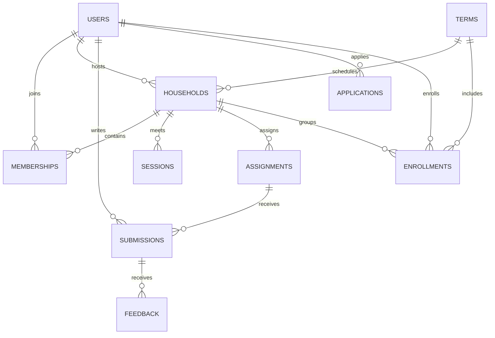

# IRIVA 工作区架构

## 运行范围

Next.js 内承载 HTTP 适配层与独立后端模块，Supabase PostgreSQL 用于生产持久化，SQLite 用于本地测试，浏览器 IndexedDB 用于离线副本、草稿与待同步操作。所有演示身份仅在 development + loopback Host 下启用，production 接口拒绝演示访问。身份切换不是正式鉴权。

当前可运行流程：报名 → 运营跟进 → 入组（同时创建成员与学期报名）→ 查看排课；学员编辑/提交练习 → Host 草稿/发布反馈 → 学员读取反馈。邮箱验证码与会话已接入；会议链接、在线支付、音频上传及自动提醒尚未接入。

## 边界

- `app/api`：解析请求、身份适配、输入校验、HTTP 错误映射。
- `domain`：纯 TypeScript 实体及 Zod 命令合同，客户端与服务端共享。
- `server/services`：访问范围、状态规则、版本冲突、组班容量、排课冲突。
- `server/repositories/workspace-repository.ts`：异步 repository 边界与 transaction-scoped unit of work。
- `server/repositories/sqlite-repository.ts`：唯一依赖 better-sqlite3 的业务数据适配器。事务使用 BEGIN IMMEDIATE 序列化容量检查和写入。
- `server/db/migrations`：本地 SQLite 版本迁移。`supabase/migrations`：独立 PostgreSQL 版本迁移，部署前显式执行。
- `server/repositories/postgres-repository.ts`：私有 schema、事务连接池与可串行化事务。
- `local`：Dexie 数据库、派生乐观视图、持久化 outbox、同步逻辑。
- `features/space`：三端界面及业务表单，不导入 SQLite、数据库连接或服务端实现。

Repository 和 unit of work 支持异步调用。PostgreSQL 在可串行化事务中读取、校验和写入，序列化失败或死锁时重试整个事务，事务内部通过 AsyncLocalStorage 复用同一连接。本地 SQLite 通过异步队列避免独立请求加入别人的未提交事务。快照由一条 SQL 读取，服务层裁剪字段与权限后返回；扩大规模时应将范围查询下推到 repository。

应用通过受限服务器角色访问私有 `iriva` schema。所有业务表启用 RLS，`anon`/`authenticated` 不直接访问业务表；应用角色没有建表或读取迁移元数据的权限。邮箱验证码及 HttpOnly 会话继续由应用验证，存储迁入 PostgreSQL，不创建 Supabase Auth 用户。

## 数据关系

每个领域实体都有应用生成的 UUID、`version`、UTC ISO-8601 `createdAt`/`updatedAt`。会员关系唯一键为 `(householdId,userId)`，提交唯一键为 `(assignmentId,learnerId)`，反馈唯一键为 `(submissionId,authorId)`，报名唯一键为 `(userId,termId)`。金额用整数最小币种单位（`amountMinor`）及 ISO 币种代码；方案价格是报名时的快照。

身份与角色在 `Actor` 接口传入，由真实会话及角色关联表生成，服务层仍然检查所属 Household、记录所有者和反馈发布状态。Host 不可读取学员未提交草稿，学员只能读取自己的提交与已发布反馈，其他成员的邮箱不会返回。

课程存储已经确定的 UTC 起止时间，Household 与用户另存 IANA 时区。当前不生成周期性课程；以后新增 recurrence rule 表，必须明确固定哪个时区，再逐次展开课程，以正确处理夏令时。所有课程状态、类别等为受约束字符串，不使用数据库专属 enum。

## 本地优先与同步协议

1. 草稿输入逐次存入 IndexedDB；编辑器关闭/刷新可恢复。
2. 点击保存/提交或勾选时，命令原子加入本地 outbox。
3. UI 由已确认快照 + 按顺序重放的待同步命令派生，未确认提交明确显示待同步。
4. 同步命令携带 UUID `id`、目标 UUID、`baseVersion`、类型化 payload。
5. 服务端在同一事务中校验权限、版本、业务规则，并写入实体、mutation receipt 和审计事件。
6. 客户端取得确认及新快照后，原子替换快照并删除该命令。若确认响应丢失，使用同一 command ID 重试，不重复执行。
7. 409 或其他确定的客户端错误保留命令并暂停该记录后续操作；用户可比较服务器与本地内容，再明确选择保留哪份。
8. 同一浏览器跨 tab 使用 Web Locks 协调同步；3 秒可见页面轮询、回到窗口和恢复网络触发刷新。

本地数据库按演示身份隔离。正式登录时必须改用真实用户 ID 作为隔离键，并在退出/切换账号时清理其私有缓存；旧的离线副本无法获知即时权限撤销，正式环境需增加会话期限与缓存保留策略。删除功能尚未实现：增加前必须引入 tombstone 与增量同步游标，不能直接删除服务器记录后仍保留旧本地视图。

Service Worker 只缓存访问过的工作区 HTML 外壳与 Next 静态资源，绝不缓存 API 响应。首次加载必须联网；浏览器清理站点存储会删除未同步的本地更改。可在设置中模拟慢网/离线。它不保证关闭浏览器后的后台同步，重新打开后继续。

## 迁移 PostgreSQL

先停写并同步浏览器 outbox，使用 `scripts/migrate-supabase.ts` 备份源 SQLite、升级备份副本，再将 25 张业务及账号表导入空的 PostgreSQL schema。保留 UUID、版本、ISO 时间、金额、会话和审计记录。JSON 集合使用 JSONB，毫秒时间戳使用 BIGINT，兼容原模型的 0/1 标记继续使用受约束整数。

导入在一个事务内完成，外键延迟到提交校验，每张表逐行规范化比对；失败回滚。迁移文件校验和与导入快照指纹分别记录在私有元数据表中。已有业务数据的目标拒绝覆盖，原始 SQLite 文件保持不变。配置受限角色的 `DATABASE_URL` 后重新部署；生产不回退到 SQLite，也不运行示例数据种子。

`npm run test:postgres` 在独立本地临时 PostgreSQL 数据库重跑账号、Host 小组、权限、并发、回滚和迁移幂等测试。原 `/api/*` DTO 与浏览器离线协议不变。具体命令与 Vercel 环境变量见 README。

## 验证重点

自动化测试覆盖权限隔离、私有草稿、提交/反馈状态、幂等、乐观版本冲突、容量、跨课程冲突、事务回滚、数据库重开、IndexedDB 重开与队列顺序。浏览器验证覆盖手机/桌面、离线提交刷新恢复、恢复同步、Host 发布反馈和运营入组。

### 本地开发与离线重新打开

构建版已验证停止服务后从 Service Worker 外壳与 IndexedDB 恢复工作区。Next.js 开发模式的热更新脚本仍依赖开发服务，开发预览离线刷新不作保证；已打开页面的草稿、乐观操作与恢复连接后的同步不受此限制。同步面板会显示当前模式的能力说明。

## 成员城市与时区

`users.city` 保存城市当地官方语言的名称（中国城市如“上海”，美国城市如“New York”，英国城市如“London”），界面直接显示，不随 UI 语言翻译。它独立于 IANA `timezone`。002 迁移为旧数据补空城市，演示种子补充明确的示例城市，真实用户不从时区推断所在地。成员列表按设备当前时刻换算各时区，每分钟与窗口恢复焦点时更新，自动处理夏令时。导出 schemaVersion 为 4，导入兼容 v1/v2/v3/v4。

## 独立机构工作区

003 迁移增加 organizations、organization_memberships，以及 Household 和报名的 organization_id。旧数据归入 IRIVA，不删除或覆盖。SQLite 在事务外短暂关闭本连接外键校验以添加带默认值的引用列，提交前执行 foreign_key_check，finally 恢复校验。

HTTP 演示身份适配器读取 x-workspace-id，服务层验证该身份在机构内的角色。读取和命令都按机构隔离；运营权限只在所属机构有效，跨机构实体 UUID 也不能用于覆盖数据。原有实际报名记录保留在 IRIVA。第二个机构 Common Ground 仅为本地演示。

IndexedDB 的历史 role 键扩展为 role:organizationId，默认 IRIVA 仍使用旧 role 键，以保留离线草稿和待同步命令。网络请求由同一 scope 推导角色与机构，不随界面切换而把旧队列发往新机构。外观和星标按机构保存。浏览历史记录机构、小组和视图，支持返回、前进、刷新与历史菜单。

## 独立聊天（004 迁移）

`channels` 独立于课程和练习，保存机构、创建者、名称、介绍和类型。`public` 对当前机构所有成员可见，仅 Host 可创建；`private` 是仅创建者可见的个人频道；`direct` 由 `channel_participants` 限定两位参与者。服务层先按机构和参与者裁剪频道，再裁剪消息，即使运营也不能读取他人的个人频道和私聊。

`conversation.open` 以机构 UUID 和排序后的两个用户 UUID 派生稳定频道 UUID，数据库同时约束 `(organization_id,direct_key)` 唯一，保证两人从任一方向发起都打开同一对话。双方必须是当前机构成员，不能给自己发起私聊。

`messages` 保存频道、作者和正文，独立于 `submissions`。`message.send` 追加消息，作者由服务端身份决定；客户端通过 IndexedDB outbox 乐观显示，保留排队时间，收到确认与快照后移除待发送状态。正文最多 12000 字符，消息搜索在有权访问的当前对话中执行。草稿按身份、机构、频道隔离。

当前是本地 MVP：消息通过可见页面每 3 秒轮询刷新；未实现已读回执、打字状态、附件、线程回复或历史分页。生产规模需将全量快照替换为按授权频道分页和增量消息同步。新建频道及首次打开私聊需联网，已有对话可离线写入队列。v4 导出包括聊天的三张表，旧版备份仍可导入，保留原 UUID 与记录。
